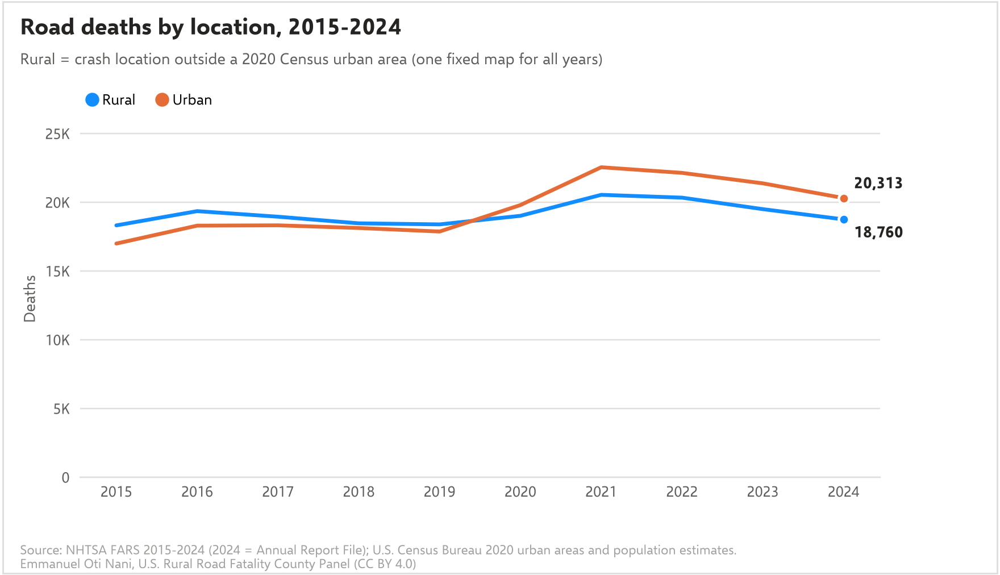
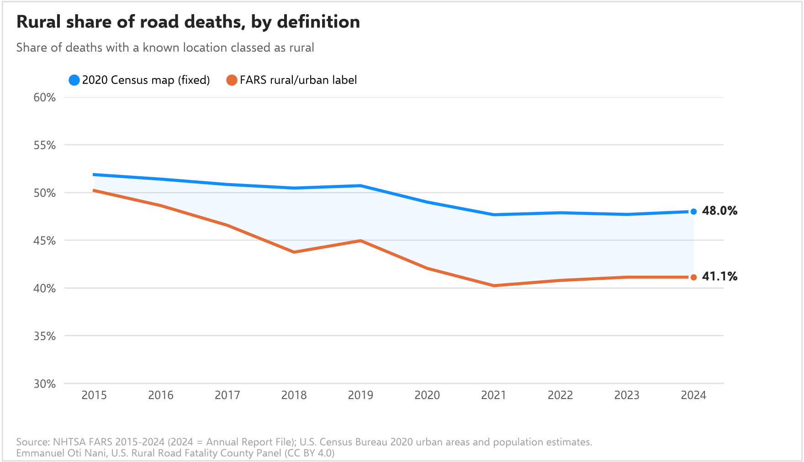
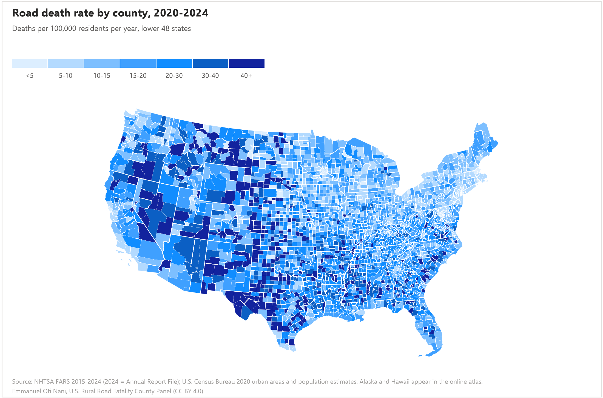
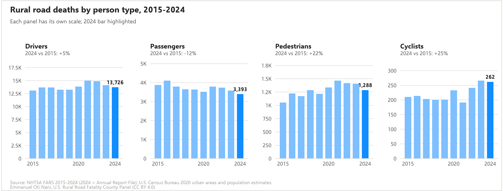

# U.S. Rural Road Fatality County Panel and Atlas

[](https://doi.org/10.5281/zenodo.23547650)

**Status:** Released v1.0.0 (2026-10-21) | **Maintainer:** Emmanuel Oti Nani, ORCID [0009-0009-4175-8962](https://orcid.org/0009-0009-4175-8962) | **License:** code MIT, data CC BY 4.0 | **DOI:** [10.5281/zenodo.23547650](https://doi.org/10.5281/zenodo.23547650) (all versions: [10.5281/zenodo.23547649](https://doi.org/10.5281/zenodo.23547649))

**In plain terms:** This is a free table of road deaths for every U.S. county, every year from 2015 to 2024. It splits deaths into rural and urban, by type of road and road owner, and by who died (driver, passenger, person walking, person on a bicycle). It adds population and public road miles. Small counties can use it as ready-made evidence for safety planning and grant applications, and researchers can use it to compare counties over a full decade.

New here? Read [docs/START_HERE.md](docs/START_HERE.md) first. Unfamiliar terms are explained in [docs/GLOSSARY.md](docs/GLOSSARY.md). The web map is the [Rural Road Safety Atlas](https://emmanuel-oti-nani.github.io/rural-road-fatality-panel/).

The panel aggregates every fatal crash in NHTSA's Fatality Analysis Reporting System (FARS), 2015-2024 (358,460 crashes, 389,190 deaths), to a fixed 2020 county geography (3,143 counties, 31,430 county-years). Each crash is classed rural or urban by its map point against the 2020 Census urban areas, a single definition held constant across years, and also by the FARS RUR_URB label used in NHTSA reporting. It joins Census population estimates, the 2020 Census rural population, and 2024 public road mileage by functional class and ownership from FHWA's Highway Performance Monitoring System. A crash-level crosswalk links each crash to its 2020 Census place and county subdivision with match flags.

## Headline numbers (from `paper/stats.json`)

In 2024, FARS records 39,254 road deaths. Placing each crash on the 2020 Census urban-area map, 18,760 (47.8%) died in rural areas. FARS's own rural label counts 16,005 (40.8%), which matches NHTSA's published figure. Over 2015-2024 the two labels agree on 88.42% of deaths (Cohen's kappa 0.768), but FARS labels 17.5% of deaths outside Census urban areas as urban. Under the fixed Census map, rural deaths went from 18,325 in 2015 to 18,760 in 2024; under the FARS label they went from 17,715 to 16,005.

## Figures

Charts are drawn in Microsoft Power BI's visual style (theme colors, Segoe UI-style font, dot legends); the shared style is `code/pbi_style.py`, and `powerbi/` has the data and theme to rebuild them as native Power BI visuals.






## What is here

```
code/            numbered scripts, run in order
data/raw/        PROVENANCE.txt (every source file: URL, date, size, SHA-256); HPMS mileage summaries
data/processed/  the panel, the long table, the crash crosswalk, qa_report.txt, review_unusual_changes.csv
docs/            START_HERE, GLOSSARY, JOIN_RULES, CODEBOOK, LIMITATIONS, VERIFY_CHECKLIST, NEXT_STEPS, TALK_TRACK, PUBLISH_GUIDE
paper/           stats.json, figures, validation tables, preprint/ (validation study: main.tex, main.pdf)
atlas/           the Rural Road Safety Atlas web map (published with GitHub Pages)
tools/           publishing helpers (pre-publication check, GitHub, Zenodo)
powerbi/         chart data and Power BI theme (see powerbi/README.md)
```

## Run it

Python 3.11 or newer. About 1 GB of downloads; the build takes about 5 minutes on a laptop, plus 30 to 60 minutes for the road-mileage queries.

```
pip install -r requirements.txt
python code/01_fetch.py          # FARS, Census maps and population (logs to data/raw/PROVENANCE.txt)
python code/01b_fetch_hpms.py    # FHWA HPMS 2024 road miles by county
python code/02_build.py          # crash crosswalk, panel, long table
python code/03_qa.py             # qa_report.txt, unusual-change flags, stats.json
python code/04_validation.py     # validation study tables
python code/05_figures.py        # figures
python code/06_atlas_data.py     # atlas data files
python code/07_docs.py           # README, codebook, talk track (numbers from stats.json)
python code/09_preprint_figures.py   # preprint figures
python code/10_preprint_tex.py       # preprint PDF (needs LaTeX with REVTeX 4.2); add --doi after the Zenodo release
python code/11_powerbi_package.py    # data and theme for rebuilding the charts in Power BI Desktop
```

A stranger running these from this README should reproduce `data/processed/` and `paper/stats.json` exactly, as long as the federal sources have not been revised. Check `data/raw/PROVENANCE.txt` fingerprints to see whether a source file changed.

## Sources

| Source | Vintage | License | Accessed |
|---|---|---|---|
| NHTSA Fatality Analysis Reporting System (FARS), national CSV files, https://www.nhtsa.gov/file-downloads?p=nhtsa/downloads/FARS/ | 2015-2023 Final; 2024 Annual Report File (released 2026-04-01) | U.S. government work, public domain | 2026-10-21 |
| U.S. Census Bureau TIGER/Line counties, places, county subdivisions, https://www2.census.gov/geo/tiger/TIGER2020/ | 2020 | Public domain | 2026-10-21 |
| U.S. Census Bureau 2020 urban areas, https://www2.census.gov/geo/tiger/TIGER2023/UAC/ | 2020 criteria (TIGER/Line 2023) | Public domain | 2026-10-21 |
| 2020 Census urban and rural population by county, https://www2.census.gov/geo/docs/reference/ua/2020_UA_COUNTY.xlsx | 2020 | Public domain | 2026-10-21 |
| Census Population Estimates, county and Connecticut town totals, https://www2.census.gov/programs-surveys/popest/datasets/ | Vintage 2019, Vintage 2024 | Public domain | 2026-10-21 |
| FHWA Highway Performance Monitoring System full-extent map layers, https://geo.dot.gov/server/rest/services/Hosted | 2024 | Public domain | 2026-10-21 |
| FHWA Highway Statistics Table HM-20, https://www.fhwa.dot.gov/policyinformation/statistics/2024/hm20.cfm | 2024 | Public domain | 2026-10-21 |

## Limitations

See [docs/LIMITATIONS.md](docs/LIMITATIONS.md) before using or citing anything here. The most important: 2024 is NHTSA's preliminary file; "rural" uses one fixed 2020 map; single-year rates in small counties are unstable; road mileage is incomplete for local roads in some states (see `miles_quality_state`).

## Citation

Emmanuel Oti Nani (2026). *U.S. Rural Road Fatality County Panel, 2015-2024* (Version 1.0.0) [Data set]. Zenodo. https://doi.org/10.5281/zenodo.23547650. See `CITATION.cff`.

## Use of AI tools

Claude (Anthropic) assisted with writing code, assembling data, and drafting documentation. Emmanuel Oti Nani designed the join rules, reviewed every flagged county, verified the published figures against the FARS source files, and is responsible for the content.
